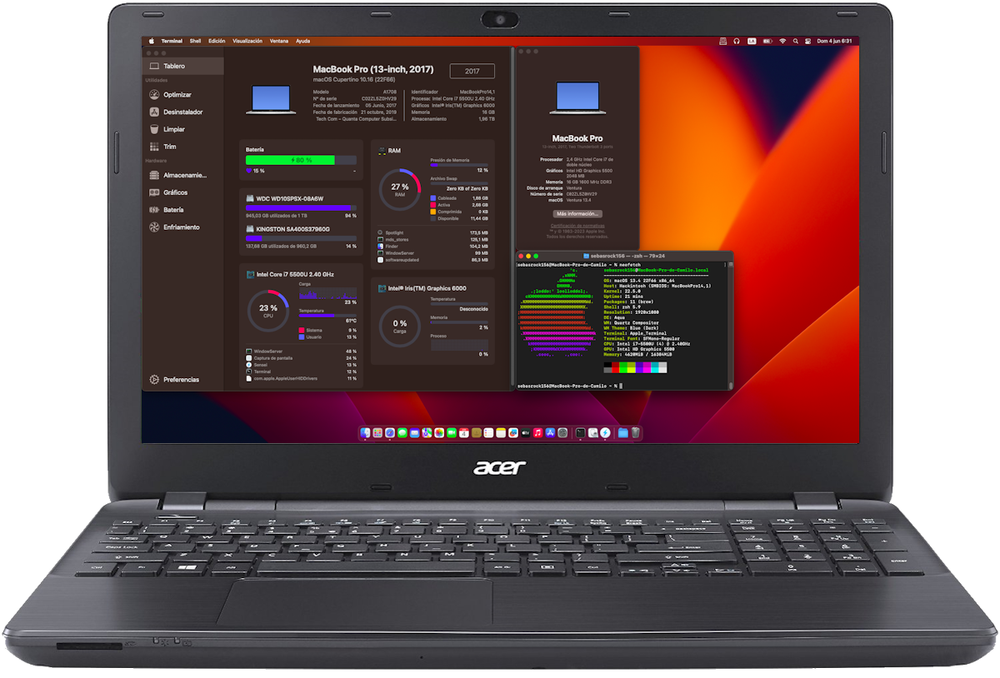

# Running every Intel-based macOS releases (from Mac OS X Tiger 10.4 to macOS Tahoe 26) on Acer E5-571-30k3 (Haswell)

OpenCore-based EFI for Acer E5-571-30k3 (Haswell)


**Status: Fully Working | Stable**

[](https://github.com/acidanthera/OpenCorePkg/releases/tag/1.0.5)

[](https://www.acer.com/fr-fr/support/product-support/Aspire_E5-571)

[](https://www.apple.com/os/macos/)
[](https://www.apple.com/macos/macos-sequoia/)
[](https://web.archive.org/web/20230926190522/https://www.apple.com/macos/sonoma/)
[](https://web.archive.org/web/20230925214840/https://www.apple.com/macos/ventura/)
[](https://web.archive.org/web/20211025225955/https://www.apple.com/macos/monterey/)
[](https://web.archive.org/web/20211018064504/https://www.apple.com/macos/big-sur/)
[](https://web.archive.org/web/20201109035708/http://www.apple.com/macos/catalina/)
[](https://web.archive.org/web/20190901002230/https://www.apple.com/macos/mojave/)
[](https://web.archive.org/web/20180907061629/https://www.apple.com/macos/high-sierra/)
[](https://web.archive.org/web/20170830032643/https://www.apple.com/macos/sierra/)
[](https://web.archive.org/web/20160902012446/http://www.apple.com/osx/)
[](https://web.archive.org/web/20150828025125/http://www.apple.com/osx/)
[](https://web.archive.org/web/20141015031940/http://www.apple.com/osx/)
[](https://web.archive.org/web/20121231120319/http://www.apple.com/osx/)
[](https://web.archive.org/web/20120609062701/http://www.apple.com/macosx/)
[](https://web.archive.org/web/20090929063403/http://www.apple.com/macosx/)
[](https://web.archive.org/web/20090528055219/http://www.apple.com/macosx/)
[](https://web.archive.org/web/20060728031552/http://www.apple.com/macosx/)

<br>
<p float="center">
	
	
</p>

## Table of Contents

1. [Introduction](#1-introduction)
2. [Summary](#2-summary)
	1. [Features](#i-features)
	2. [Hardware](#ii-hardware)
	3. [HCL](#iii-hcl)
3. [Build](#3-build)
	1. [Processor](#i-processor)
	2. [Graphic Card](#ii-graphic-card)
	3. [Storage](#iii-storage)
	4. [Ethernet](#iv-ethernet)
	5. [Audio](#v-audio)
	6. [Bluetooth](#vi-bluetooth)
	7. [Wifi](#vii-wifi)
	8. [Ps2 Devices](#viii-ps2-devices)
	9. [CardReader](#ix-cardreader)
	10. [DVD RW - Battery](#x-dvd-rw-and-battery)
4. [Contents](#4-contents)
	1. [This is not a Guide!](#i-this-is-not-a-guide)
	2. [This is a Guide!](#ii-this-is-a-guide)
	3. [Working](#iii-working)
	4. [Not Working](#iv-not-working)
	5. [Software](#v-software)
	6. [Kernel](#vi-kernel)
	7. [ACPI](#vii-acpi)
	8. [Kext](#viii-kext)
	9. [UEFI Drivers](#ix-uefi-drivers)
	10. [config.plist](#x-configplist)
	11. [Video](#xi-video)
	12. [Screenshots](#xii-screenshots)
	13. [Relevant Repositories](#xiii-relevant-repositories)
	14. [Credits](#xiv-credits)
5. [Installation](#5-installation)
	1. [UEFI Settings](#i-uefi-settings)
	2. [macOS Installation](#ii-macos-installation)
6. [Conclusion](#6-conclusion)

</br>

## 1. Introduction

I was inspired to create this project while preparing macOS installers, from **Mac OS X Tiger 10.4** to **macOS Tahoe 26**, on an external hard drive. I wanted to test each installer and make sure they worked properly.

I still wanted to test older Mac OS X versions, then I found this [repository](https://github.com/HJebbour/HP-ProDesk-400-G1-Hackintosh-every-macOS/) about running all Intel-based macOS releases on a single computer. That project motivated me to try something similar, I had a suitable machine available: an **Acer E5-571-30k3** based on Haswell hardware.

From that point, the real fun began. The goal was to build a Hackintosh capable of running every Intel-based Mac OS X and macOS version, from **Mac OS X Tiger 10.4** to **macOS Tahoe 26**, using **one single EFI folder** that allows all supported Intel macOS versions to boot on the same computer. Work was a little bit harder than a desktop because a laptop have more peripherals. 

Please note that **macOS Tahoe 26 support is currently limited**, especially regarding GPU acceleration. At the time of this update, **OpenCore Legacy Patcher has not yet been updated to fully support macOS Tahoe**, so graphics acceleration, sound and Wifi will not work until OCLP team release an update that supports macOS Tahoe.

This Hackintosh is also one of the most powerful machines capable of running **Mac OS X Tiger**, especially considering that version **10.4.4**, the first Intel release, was introduced in 2006, long before this 2015-era hardware existed. I noticed that Mac OS X 10.6 and earlier feel especially snappy and responsive on this system. I discover Mac OS X experience and the Aqua interface, at theses times I was a Windows user and Later a Linux user.

</br>

This project was created using the [Dortania](https://dortania.github.io/getting-started/) guide specifically for the Acer E5-571-30k3.

**DISCLAIMER:** As you embark on your Hackintosh journey you are encouraged to **READ** the entire README and [Dortania](https://dortania.github.io/getting-started/) guides before you start.

This Acer E5-571-30k3  Hackintosh project aims to be an all-in-one maintained hub for Opencore-based hackintoshes on the Acer Laptop family. In short, this Acer E5-571-30k3 Hackintosh is very stable and can be used as daily driver. I fully recommend this project to anyone looking for an old Mac Pro alternative.

You can find a wealth of knowledge on [Reddit](https://www.reddit.com/r/hackintosh/), [TonyMacX86](https://www.tonymacx86.com) or [Google](https://www.google.com).

Should you find an error, or improve anything, be it in the config itself or in the my documentation, please consider opening an issue or a pull request to contribute.

**I am not responsible for any damages you may cause.**

</br>

## 2. Summary

### i. Features

- Same **hardware** configuration: No need to swap Wifi/Bluetooth module. All peripherals OOB Except HDD/SSD was swapped in 2020 and HDD was moved to external. 
- Same **BIOS** configuration: No need to change BIOS configuration to run a specific macOS version.
- Same **connectors**: No need to switch video output, LAN, USB to run a specific macOS version.
- Same **bootloader**: No need to use different bootloader like Chameleon or Clover for older macOS versions. OpenCore covers all Intel macOS releases.
- Same **config.plist**: No need to have multiple config.plist to run specific macOS versions.

</br>

### ii. Hardware

#### HP Acer E5-571-30k3 
These are relevant components on my machine that may differ from yours, so keep these in mind as you will need to adjust accordingly, depending on your machine's configuration.

| Category  | Component                                       |
| --------- | ----------------------------------------------- |
| Processor | Intel Core i3-4005U CPU @ 1.70GHz |
| Graphic Card | Intel HD Graphics 4400 (HSW GT2) |
| Storage | 256 GB SATA SSD (APFS High Sierra to Tahoe), 1TB SATA HDD (HPFS Tiger to Sierra), and 16GB USB flash drive |
| Memory | 6 GB 1600 MHz DDR3 |
| Audio | Realtek ALC283 |
| Ethernet | Realtek RTL8111 |
| Wifi | Atheros AR9462 (Combo with Bluetooth)|
| Bluetooth | Foxcon / Hon Hai 0489:e04e (AR3012) |
| Keyborad | PS2 type |
| Touchpad | PS2 Synaptic SYN1B7E|
| Cardreader | Realtek RTL8411B |
| DVD R/W | Matsushita |
| Webcam | Realtek 0bda:57b8 |
| Battery | Sanyo Li-ion |
| Board | EA50_HB |
| BIOS | Insyde Corp V1.32 (15/09/2015) |

</br>

### iii. HCL
This is an overview of the hardware compatibility status across all Intel-based Mac OS X and macOS versions, from **Mac OS X Tiger 10.4** to **macOS Tahoe 26**.

| macOS        | i3-4005U | AHCI SSD | iGPU 4400 | RTL8111 | ALC283 | AR3012  | AR9462  | RTL8111 |
| :----------: | :------: | :------: | :-------: | :-----: | :----: | :-----: | :-----: | :-----: |
| Tahoe         | ✅ | ✅ | 4️⃣ | ✅ | 4️⃣ | ✅ | 4️⃣ | ✅ |
| Sequoia       | ✅ | ✅ | 3️⃣ | ✅ | ✅ | ✅ | 3️⃣ | ✅ |
| Sonoma        | ✅ | ✅ | 3️⃣ | ✅ | ✅ | ✅ | 3️⃣ | ✅ |
| Ventura       | ✅ | ✅ | 3️⃣ | ✅ | ✅ | ✅ | 3️⃣ | ✅ |
| Monterey      | ✅ | ✅ | ✅ | ✅ | ✅ | ✅ | 3️⃣ | ✅ |
| Big Sur       | ✅ | ✅ | ✅ | ✅ | ✅ | ✅ | ✅ | ✅ |
| Catalina      | ✅ | ✅ | ✅ | ✅ | ✅ | ✅ | ✅ | ✅ |
| Mojave        | ✅ | ✅ | ✅ | ✅ | ✅ | ✅ | ✅ | ✅ |
| High Sierra   | ✅ | ✅ | ✅ | ✅ | ✅ | ✅ | ✅ | ✅ |
| Sierra        | ✅ | ✅ | ✅ | ✅ | ✅ | ✅ | ✅ | ✅ |
| El Capitan    | ✅ | ✅ | ✅ | ✅ | ✅ | ✅ | ✅ | ✅ |
| Yosemite      | ✅ | ✅ | ✅ | ✅ | ✅ | ✅ | ✅ | ✅ |
| Mavericks     | ✅ | ✅ | ✅ | ✅ | ✅ | ✅ | ✅ | ✅ |
| Mountain Lion | ✅ | ✅ | ✅ | ✅ | ✅ | ✅ | ✅ | ✅ |
| Lion          | 1️⃣ | ✅ | ✅ | ✅ | ✅ | ✅ | ✅ | ✅ |
| Snow Leopard  | 1️⃣ | ✅ | ✅ | ✅ | ✅ | ✅ | ✅ | ✅ |
| Leopard       | 1️⃣ | ✅ | ✅ | ✅ | ✅ | ✅ | 5️⃣ | ✅ |
| Tiger         | 1️⃣ | 2️⃣ | ✅ | ✅ | ✅ | ✅ | 5️⃣ | ✅ |

1️⃣ Spoof CPUID to Nehalem (`0x0106A2`)  

2️⃣ Install Mac OS X Tiger on a USB drive  

3️⃣ Install [OpenCore Legacy Patcher](https://github.com/dortania/OpenCore-Legacy-Patcher)  

4️⃣ macOS Tahoe 26 boots, but GPU acceleration / Wifi / Audio are not working yet.

5️⃣ Use a USB Wifi compatible device if need  

</br>

## 3. Build

### i. Processor

The beauty of the Intel 4th Gen Core Series is that it is old enough to run Mac OS X Tiger 10.4 and recent enough to run macOS Sequoia natively. However, you will need a custom kernel in Mac OS X Tiger 10.4, and spoof CPUID to Nehalem for Mac OS X Tiger 10.4 to Lion 10.7.  

</br>

### ii. Graphic Card

I can't change the graphic card on the laptop, I had to keep the embedded Haswell iGPU.  

</br>

### iii. Storage

- The first problem with storage is that AHCI causes kernel panic with Mac OS X Tiger, so I had to disable `AppleAHCIPort` for 10.4 in the config.plist file and install Tiger to USB drive.  
- The other macOS releases can be installed on any SATA SSD without any problem.  

</br>

### iv. Ethernet

It was a bit complicated to get my Ethernet (Realtek RTL8111) to work on all versions of macOS. I had to use three different kexts:  
- [RealtekR1000](https://sourceforge.net/projects/realtekr1000/) for Mac OS X Tiger while forcing `IONetworkingFamily`.  
- Patched originals RTL8169 for Leopard and Snow Leopard, replace patched binary in /S/L/E + rewrite Kexts cache, see [Ethernet.zip](Ethernet/Ethernet.zip) and relevant Post-Installation sections.    
- [RealtekRTL8111 v1.2.3](https://github.com/Mieze/RTL8111_driver_for_OS_X/releases/) for macOS Lion and later.  

</br>

### v. Audio

On-board audio Realtek ALC283:  
- Mac Tiger to Lion: I had to rework a new FAT kext, see my repo : [VoodooHda](https://github.com/enigma131/VoodooHDA)  
- Working on OS X Mountain Lion and later (to Sequoia) using `AppleALC` with layout-id 15 and `SSDT-HPET.aml`.  

</br>

### vi. Bluetooth

Embedded internal AR3012 Usb device:  
- Mac OS X Tiger through Yosemite: use EMlyDinEsH based kext [BTFirmwareUploader](https://github.com/EMlyDinEsHMG/BTFirmwareUploader) , recompiled FAT version.  
- El Capitan and up: use zxystd [AthBluetoothFirmware](https://github.com/zxystd/AthBluetoothFirmware). Configuration in kext's info.plist  
- Rewrite `BlueToolFixup.kext` for macOS Monterey and later. See my repo: [BrcmPatchRAM](https://github.com/enigma131/BrcmPatchRAM)  

</br>

### vii. Wifi

Embedded internal AR9462 Pcie device:  
- Mac OS X Tiger and Leopard: no kext, use external USB compatible device if need.  
- Snow Leopard to High Sierra: replace patched binary + info.plist in /S/L/E + rewrite Kexts cache, see [Wifi.zip](Wifi/Wifi.zip) and relevant Post-Installation sections.  
- Mojave to Sequoia uses kexts: `corecaptureElCap + IO80211ElCap.kext + AirPortAtheros40.kext`  
- Monterey to Sequoia : uses OCLP 2.4.1 : [OpenCore-Legacy-Patcher](https://github.com/dortania/OpenCore-Legacy-Patcher/releases)  
- Tahoe: no solution yet.  

</br>

### viii. PS2 devices 
(Embedded touchpad and keyboard)  
Original 3 kexts from EMlyDinEsH was working OOB for 64 Bits OSs, I had to recompile a FAT version to cover Tiger to Tahoe with no restrictions.  
See my repo: [ApplePS2SmartTouchPad](https://github.com/enigma131/ApplePS2SmartTouchPad). Configurations in matching info.plist  

</br>

### ix. Cardreader

Original kexts from cholonam was working for Sierra and up. I had to recompile a Fat version to cover Tiger to Tahoe with no restrictions.  
See my repo: [Sinetek-rtsx](https://github.com/enigma131/Sinetek-rtsx)  

</br>

### x. DVD RW and Battery
Works OOB, battery with matching existing kext + SSDT  
Sata DVD can use a kernel patch to remove unnecessary logs, see section kernel patch.   

</br>

## 4. Contents

### i. This is not a Guide!

This is not a guide. It should only be used as a reference or if you have the exact same machine. I give a few tips and tricks I've learned on my journey into building a hackintosh. The best way of using this is as a companion to the OpenCore guide. If you have questions about how to setup your specific hardware, are unclear about what to do, or would like to see the settings I've used.  

I understand that some may simply add the OC and Boot folders to their EFI folder. For clarity the EFI partition needs a folder called EFI that contains the Boot and OC folder.  

```
EFI (partition)
	EFI
	├── BOOT
	├── OC
```

It should work and your Acer E5-571-30k3  should boot and operate correctly. **At the very least, you'll need to generate SMBIOS values if you want Apple services to work.** Note that all error reporting/logging has been turned off in the config.plist. You will have a difficult time trouble shooting with the setup provided. You can easily turn on the error reporting and logging if you follow the [Dortania](https://dortania.github.io/OpenCore-Install-Guide/troubleshooting/debug.html) guide. Best of luck.  

> **NOTE** if you simply wish to copy my EFI please do the following:
>
>1. [Generate SMBIOS values](https://dortania.github.io/OpenCore-Install-Guide/config-laptop.plist/coffee-lake-plus.html#nvram) and add them in the config.plist (Use specific SMBIOS depending on which macOS you want to install, see below for more info)
>2. Ensure the value of `showpicker` is  `true` in the config.plist file to provide the opencore menu when booting. 
>3. Prepare your install [USB](https://dortania.github.io/OpenCore-Install-Guide/installer-guide/)
>4. Move the entire EFI folder (with your modifications) to the proper partition on your [USB](https://dortania.github.io/OpenCore-Install-Guide/installer-guide/mac-install.html#setting-up-opencore-s-efi-environment) (or [SSD](https://dortania.github.io/OpenCore-Post-Install/universal/oc2hdd.html) once the install is complete).
>5. [Install](https://dortania.github.io/OpenCore-Install-Guide/installation/installation-process.html#double-checking-your-work) - You'll need to select F12 to get the boot menu options and **boot from the USB each time the computer restarts** until you've copied the EFI folder onto the hard drive. You may also need to select the correct boot option during install.

</br>

### ii. This is a Guide!

**If you have a slightly different computer, you should follow the one and only guide to macOS installation guide provided by [Dortania](https://dortania.github.io/OpenCore-Install-Guide/)**

</br>

### iii. Working

> #### Video and Audio
| Feature                              | Status | Dependency          | Remarks                      |
| :----------------------------------- | ------ | ------------------- | ---------------------------- |
| Full Graphics Accleration            | ✅ | `WhateverGreen.kext` | OCLP 2.4.1 is need from Ventura to Sequoia and no graphic accel from Tiger to ML |
| Audio Output (Front/Back)            | ✅ | `SSDT-HPET.aml`, `AppleALC.kext` with Layout ID = 15 and `VoodooHDA-FAT.kext` |  |
| Audio Input (Front/Back)             | ✅ | `SSDT-HPET.aml`, `AppleALC.kext` with Layout ID = 15 and `VoodooHDA-FAT.kext` |  |
| Internal Speaker                     | ✅ | `SSDT-HPET.aml`, `AppleALC.kext` with Layout ID = 15 and `VoodooHDA-FAT.kext` |  |
| Automatic Headphone Output Switching | ✅ | `SSDT-HPET.aml`, `AppleALC.kext` with Layout ID = 15 and `VoodooHDA-FAT.kext` |  |

> #### Power Management
| Feature                              | Status | Dependency          | Remarks                      |
| :----------------------------------- | ------ | ------------------- | ---------------------------- |
| CPU Power Management | ✅ | `SSDT-PLUG.aml` | Not working on Mac OS X Tiger to Lion |
| Sleep / Wake         | ✅ | - | Not working on Mac OS X Tiger to ML |

> #### Connectivity
| Feature           | Status | Dependency          | Remarks                      |
| :-----------------| ------ | ------------------- | ---------------------------- |
| Bluetooth         | ✅ | `BlueToolFixup.kext` | need firmware injections in all cases, see above, Modified `BlueToolFixup.kext` is required on macOS Monterey and later |
| Ethernet          | ✅ | `RealtekR1000.kext`, patched kext , and `RealtekRTL8111.kext` |   |
| USB 2.0 / USB 3.0 | ✅ | `USBToolBox.kext` `UTBMap.kext` | Create your own UTBMap.kext using [dhinakg](https://github.com/USBToolBox/tool) |
| Card Reader       | ✅ | `Sinetek-rtsx.kext` | [Sinetek-rtsx](https://github.com/enigma131/Sinetek-rtsx) |
| PS2 devices       | ✅ | `ApplePS2SmartTouchPad.kext` `ApplePS2Controller.kext` `ApplePS2Keyboard.kext` | [ApplePS2SmartTouchPad](https://github.com/enigma131/ApplePS2SmartTouchPad) |
| Wifi              | ✅ | `corecaptureElCap.kext` `IO80211ElCap.kext` `AirPortAtheros40.kext`  and patched kexts|   |


> #### Miscellaneous
| Feature            | Status | Dependency          | Remarks                      |
| :------------------| ------ | ------------------- | ---------------------------- |
| DVD / Battery mgmt | ✅ |    |  Works like a charme |

</br>

### iv. Not Working

**Everything is working!**

</br>

### v. Software

| Component      | Version |
| -------------- | ------- |
| OpenCore | 1.0.5 |
| OpenCore Legacy Patcher | 2.4.1 |
| macOS Tahoe | 26.7 (25G229) |
| macOS Sequoia | 15.8 (24H23) |
| macOS Sonoma | 14.8.9 (23J631) |
| macOS Ventura | 13.7.8 (22H730) |
| macOS Monterey | 12.7.6 (21H1320) |
| macOS Big Sur | 11.7.11 (20G1443) |
| macOS Catalina | 10.15.8 (19H2036) |
| macOS Mojave | 10.14.6 (18G9323) |
| macOS High Sierra | 10.13.6 (17G14042)) |
| macOS Sierra | 10.12.6 (16G2136) |
| OS X El Capitan | 10.11.6 (15G22010) |
| OS X Yosemite | 10.10.5 (14F2511) |
| OS X Mavericks | 10.9.5 (13F1911) |
| OS X Mountaion Lion | 10.8.5 (12F2560) |
| Mac OS X Lion | 10.7.5 (11G1120) |
| Mac OS X Snow Leopard | 10.6.8 (10K549) |
| Mac OS X Leopard | 10.5.8 (9L31a) |
| Mac OS X Tiger | 10.4.11 (8S2167) |

</br>

### vi. Kernel

Mac OS X Tiger cannot run on this computer with vanilla kernel, it needs a custom kernel from the early hackintosh distros. I used [8.9.1 kernel SSE3 apr18](Custom%20Kernel/mach_kernel) custom kernel extracted from [XxX OS x86 10.4.11](https://archive.org/details/xxxosx8610point4point11rev2_202007).

Then we need to copy it to the USB installer, to the disk after installation, and after applying each update before rebooting, otherwise you won't be able to boot Mac OS X Tiger.

</br>

### vii. ACPI

| Component              | Description            |
| ---------------------- | ---------------------- |
| SSDT-EC | Fixes the embedded controller |
| SSDT-PLUG | Allows for native CPU power management |
| SSDT-HPET | Used for resolving IRQ conflicts (Fixing Audio issue with AppleALC) |
| SSDT-PNLF | Used for Backlight Level Control |
| SSDT-ARPT | Add ACPI name for WiFi Card, need for OCLP |
| SSDT-SBUS-MCHC | Defines an MCHC and BUS0 device for SMBus compatibility SSDTTime |

</br>

### viii. Kext

| Kext        | Version | Description    |
| ----------- | ------- | -------------- |
| Lilu | 1.7.2 | Used for arbitrary kext, library, and program patching on Mac OS X Snow Leopard and later only, due to kernel panic on 32-bit only kernels |
| VirtualSMC | 1.3.7 | Used to emulate Apple SMC in the kernel on Mac OS X Snow Leopard and later only, due to kernel panic on 32-bit only kernels |
| FakeSMC-32 | 2.5 | Used to emulate Apple SMC on Mac OS X Tiger and Leopard (32-bit only kernels) |
| WhateverGreen | 1.7.1 | Used to patch GPU on Mac OS X Snow Leopard and later |
| SMCProcessor | 1.3.7 | Used to monitor Intel CPU temperature on Mac OS X Lion and later |
| AppleACPIBatteryManager | 1.0.15 | Used to monitor Battery on Mac OS X tiger and Leopard |
| ACPIBatteryManager | 1.90.1 | Used to monitor Battery on Snow Leopard through macOS Tahoe |
| VoodooHDA | 3.2.0 | FAT Compiled/assembled Audio support for Mac OS X tiger to Lion |
| AppleALC | 1.9.6 | Used to enable onboard audio on OS X Mountain Lion and later |
| RealtekR1000 | 1.0.4 | Used to enable ethernet on Mac OS X Tiger and Leopard |
| RealtekRTL8111 | 1.2.3 | Used to enable ethernet on Mac OS X Snow Leopard through macOS Tahoe |
| GenericUSBXHCI | 1.2.7 | Used to enable XHCI on Lion/ML/Mavericks |
| USBToolBox | 1.2.0 | El Capitan through macOS Tahoe |
| UTBMap | 1.1 | Used to map USB ports on El Capitan  |
| BTFirmwareUploaderFAT| 3.1.5 | FAT recompiled version, from Tiger to Yosemite |
| Ath3kBT| 1.1.0 | from Ath3k Linux/BSD by zxystd, El Capitan through macOS Tahoe|
| Ath3kBTInjector| 1.0.0 | by zxystd, El Capitan to Big Sur|
| BlueToolFixup | 2.7.2 | Used to enable USB Bluetooth dongle support on macOS Monterey and later |
| AMFIPass | 1.4.1 | Used to enable OpenCore Legacy Patcher on macOS Big Sur and later |
| corecaptureElCap | 1.0.4 | For wifi on Mojave through macOS Tahoe |
| IO80211ElCap | 1110.26  | For wifi on Mojave through macOS Tahoe |
| AirPortAtheros40 | 700.74.5 | For wifi on Mojave through macOS Tahoe |
| WifiLocFix | 9.9.9 | countrycode 4 wifi |
| ApplePS2SmartTouchPad | 4.6.9 | Fat compiled version, works from Tiger to Tahoe |
| ApplePS2Controller | 4.6.9 | Fat compiled version, works from Tiger to Tahoe |
| ApplePS2Keyboard | 4.6.9 | Fat compiled version, works from Tiger to Tahoe |
| Sinetek-rtsx | 9.1.0 | Fat compiled version, works from Tiger to Tahoe |
| RestrictEvents | 1.1.6 | Used to patch various functions on macOS Big Sur and later |
| RTCMemoryFixup | 1.0.7 | fix wake crash with rtc-blacklist  on macOS Mountain Lion and later |

</br>

### ix. UEFI Drivers

|     Driver      | Version           | Description       |
| --------------- | ----------------- | ----------------- |
| OpenRuntime | OpenCorePkg 1.0.5 | Essentiel to patch boot.efi for NVRAM fixes |
| OpenCanopy | OpenCorePkg 1.0.5 | Enable graphical boot picker |
| HfsPlus | OpenCorePkg 1.0.5 | Required to see HFS volumes (macOS Installers and Recovery partitions |
| ResetNvramEntry | OpenCorePkg 1.0.5 | Allow to reset NVRAM from boot picker |

</br>

### x. config.plist

The following `config.plist`  has been optimized to boot all Intel-based macOS releases without extra Quirks and patches. The settings provided are specific to the Acer E5-571-30k3 and may not be applicable to your computer.

Please refer to [Dortania's OpenCore Install Guide](https://dortania.github.io/OpenCore-Install-Guide/) and [OpenCore Reference Manual](https://dortania.github.io/docs/latest/Configuration.html) to adapt your `config.plist` to your system.

In this section I will explain each parameter used in `config.plist` to give you an overview of this hackintosh.

<details> 
<summary><strong>ACPI</strong></summary>

#### Add
`SSDT-EC.aml`

`SSDT-PLUG.aml`

`SSDT-HPET.aml`

`SSDT-PNLF.aml`

`SSDT-ARPT.aml`

`SSDT-SBUS-MCHC.aml`

`SSDT-FNQ11Q12.aml`

#### Patch
These 5 first patches are generated when choosing SSDT-HPET patch with SSDTTime.
_PRW to XPRW for 3 first conditions, USB map after wake from sleep.
_Q11 to XQ11 and _Q12 to XQ12 with SSDT-FNQ11Q12.aml Brithness key remap.


| Find            | Replace         | Comment                 |
| --------------- | --------------- | ----------------------- |
| 275F535441      | 2758535441      | HPET_STA to XSTA Rename |
| 46055F435253    | 460558435253    | HPET_CRS to XCRS Rename |
| 2204007900      | 2200007900      | IPIC IRQ 2 Patch        |
| 2200017900      | 2200007900      | RTC IRQ 8 Patch         |
| 2201007900      | 2200007900      | TIMR IRQ 0 Patch        |
| 140F5F50525700  | 140F5850525700  | _PRW to XPRW Patch      |
| 5F513131        | 58513131        | _Q11 to XQ11 Patch      |
| 5F513132        | 58513132        | _Q12 to XQ12 Patch      |

</details>

<details> 
<summary><strong>Booter</strong></summary>

#### Quirks
The following Quirks are used:

- `AvoidRuntimeDefrag`: Fixes UEFI runtime services like date, time, NVRAM, power control, etc.

- `DiscardHibernateMap`: Handle Multi boot with Windows Hibernate.

- `EnableSafeModeSlide`: Enables slide variables to be used in safe mode, however this quirk is only applicable to UEFI platforms.

- `EnableWriteUnprotector`: Needed to remove write protection from CR0 register.

- `ProvideCustomSlide`: Handle Address Space Layout Randomization.

- `SetupVirtualMap`: Fixes SetVirtualAddresses calls to virtual addresses.

</details>

<details> 
<summary><strong>DeviceProperties</strong></summary>

</br>

Settings for Audio ALC 283 and VoodooHDA.  

#### PciRoot(0x0)/Pci(0x1B,0x0)

| Key                      | Value                          | String    |
| ------------------------ | ------------------------------ | --------- |
| AAPL,slot-name           | Internal@0,27,0                | `STRING`  |
| device_type              | Audio device                   | `STRING`  |
| voodoo-layout-id         | 80                             | `INTEGER` |
| layout-id                | 15                             | `INTEGER` |
| model                    | 8 Series HD Audio Controller   | `STRING`  |


Settings for Wifi Atheros AR9462.  
IOName spoofing for Opencore Legacy Patcher  

#### PciRoot(0x0)/Pci(0x1C,0x3)/Pci(0x0,0x0) 

| Key                      | Value                          | String    |
| ------------------------ | ------------------------------ | --------- |
| AAPL,slot-name           | Internal@0,28,3/0              | `STRING`  |
| IOName                   | pci168c,30                     | `STRING`  |
| device_type              | Airport                        | `STRING`  |
| model                    | Atheros Wireless Lan PCI       | `STRING`  |
| name                     | AR9462                         | `STRING`  |


Settings for Haswell iGPU  
platform and device IDs refer to the [Dortania guide](https://dortania.github.io/OpenCore-Install-Guide/config.plist/haswell.html#add-2).  
disable-agdc see : [insanelymac](https://www.insanelymac.com/forum/topic/361829-solved-need-help-with-ssdt-pnlf-and-wake-from-sleep-issue/#comment-2842997).  
framebuffer setting for HDMI out, VGA out don't need it  

#### PciRoot(0x0)/Pci(0x1,0x0)/Pci(0x0,0x0)

| Key                        | Value        | String    |
| -------------------------- | -------------| --------- |
| AAPL,ig-platform-id        | 0600260A     | `DATA`    |
| device-id                  | 12040000     | `DATA`    |
| disable-agdc               | 01000000     | `DATA`    |
| framebuffer-con2-enable    | 01000000     | `DATA`    |
| framebuffer-con2-type      | 00080000     | `DATA`    |
| framebuffer-patch-enable   | 01000000     | `DATA`    |

Other settings are cosmetics 

</details>

<details> 
<summary><strong>Kernel</strong></summary>

#### Add
Adding Kexts with MinKernel and MaxKernel, and Arch type to allow booting all macOS releases from the same EFI folder.

Please refer to the [Kernel Support Table](https://dortania.github.io/OpenCore-Install-Guide/config.plist/haswell.html#add-3).

| Arch   | BundlePath                   | MinKernel | MaxKernel |
| ------ | ---------------------------- | --------- | --------- |
| x86_64 | Lilu.kext                    | 10.0      |           |
| x86_64 | VirtualSMC.kext              | 10.0      |           |
| i386   | FakeSMC-32.kext              |           | 9.9       |
| x86_64 | WhateverGreen.kext           | 14.0      |           |
| x86_64 | SMCProcessor.kext            | 12.0      |           |
| i386   | AppleACPIBatteryManager.kext |           | 9.9       |
| x86_64 | ACPIBatteryManager.kext      | 10.0      |           |
| Any    | VoodooHDA.kext               | 10.0      | 11.9      |
| x86_64 | AppleALC.kext                | 12.0      |           |
| i386   | RealtekR1000.kext            |           | 8.99      |
| x86_64 | RealtekRTL8111.kext          | 11.0      |           |
| x86_64 | GenericUSBXHCI.kext          | 11.0      | 13.9      |
| x86_64 | USBToolBox.kext              | 15.0      |           |
| x86_64 | UTBMap.kext                  | 15.0      |           |
| Any    | BTFirmwareUploaderFAT.kext   |           | 14.9      |
| x86_64 | Ath3kBT.kext                 | 15.0      |           |
| x86_64 | Ath3kBTInjector.kext         | 15.0      |           |
| x86_64 | BlueToolFixup.kext           | 21.0      |           |
| x86_64 | AMFIPass.kext                | 22.0      |           |
| x86_64 | corecaptureElCap.kext        | 18.0      |           |
| x86_64 | IO80211ElCap.kext            | 18.0      |           |
| x86_64 | AirPortAtheros40.kext        | 18.0      |           |
| x86_64 | WifiLocFix.kext              | 10.0      |           |
| Any    | ApplePS2SmartTouchPad.kext   |           |           |
| Any    | ApplePS2Controller.kext      |           |           |
| Any    | ApplePS2Keyboard.kext        |           |           |
| Any    | Sinetek-rtsx.kext            |           |           |
| x86_64 | RestrictEvents.kext          | 22.0      |           |
| x86_64 | RTCMemoryFixup.kext          | 12.0      |           |

#### Block
Blocking kexts to prevent kernel panic on Mac OS X Tiger 10.4 and Mac OS X Leopard 10.5. As a result, AHCI is unusable in Mac OS X Tiger 10.4, and must be installed on a USB drive.  
Disable AppleHDA for VodooHDA

| Arch | Identifier                     | MinKernel | MaxKernel | Strategy  |
| ---- | ------------------------------ | --------- | --------- | --------- |
| i386 | com.apple.driver.AppleAHCIPort |           | 8.99      | Disable   |
| i386 | com.apple.driver.EFIRuntime    |           | 9.9       | Disable   |
| Any  | com.apple.driver.AppleHDA      |           | 11.9      | Disable   |

#### Force
Force loading `IONetworkingFamily.kext` to allow Ethernet to run on OS X Tiger.  
Force loading `IOAudioFamily.kext` and `OSvKernDSPLib.kext` to allow VoodooHDA to run on OS X Tiger and Leopard.  

| Arch | BundlePath                                        | Identifier                         | ExecutablePath                    | PlistPath           | MinKernel | MaxKernel |
| ---- | ------------------------------------------------- | ---------------------------------- | --------------------------------- | ------------------- | ----------- | --------- |
| i386 | System/Library/Extensions/IONetworkingFamily.kext | com.apple.iokit.IONetworkingFamily | Contents/MacOS/IONetworkingFamily | Contents/Info.plist |           | 8.99      |
| Any  | System/Library/Extensions/IOAudioFamily.kext      | com.apple.iokit.IOAudioFamily      | Contents/MacOS/IOAudioFamily      | Contents/Info.plist |           | 9.9       |
| Any  | System/Library/Extensions/OSvKernDSPLib.kext      | com.apple.kext.OSvKernDSPLib       | Contents/MacOS/OSvKernDSPLib      | Contents/Info.plist |           | 9.9       |

#### Patch
`DummyPowerManagement` is required for Mac OS X Montain Lion  to avoid kernel panic. Instead of enabling it in `Emulate`, an equivalent patch is applied to target only ML and earlier.  
com.apple.driver.AppleRTC patch against unwanted wakes.  
com.apple.driver.AppleAHCIPort patch against unwanted logs from DVD interface, see [insanelymac](https://www.insanelymac.com/forum/topic/361676-solved-how-to-disable-sata-dvd-atapi-device-spamming-messages-ventura-133/?do=findComment&comment=2842694).
com.apple.iokit.BroadcomBluetoothHostControllerUSBTransport patch against Broadcom kext disturbing Atheros Bluetooth job at El Capitan  

|  Arch  | Identifier                                                  | Base / Find                                          | Replace       | MinKernel | MaxKernel | Count |
| ------ | ----------------------------------------------------------- | ---------------------------------------------------- | ------------- | --------- | --------- | ----- |
| Any    | com.apple.driver.AppleIntelCPUPowerManagement               | __ZN28AppleIntelCPUPowerManagement5startEP9IOService | B8010000 00C3 |           | 11.9      | 1     |
| x86_64 | com.apple.driver.AppleRTC                                   | __ZN8AppleRTC18setupDateTimeAlarmEPK11RTCDateTime    | C3            |  12.0     |           | 1     |
| x86_64 | com.apple.iokit.BroadcomBluetoothHostControllerUSBTransport |B001EB02                                              | B000EB02      |  15.0     | 15.99     | 1     |
| i386   | com.apple.driver.AppleACPIPlatform                          | __GLOBAL__I__ZN15AppleACPIPS2Nub10gMetaClassE        | C3            |           | 8.99      | 1     |
| x86_64 | com.apple.driver.AppleAHCIPort       | find:    5B414843495D5B5052545D5B253038585D2025733A3A25643A506F7274202564202D206361 |       |  22.0     |           | 1     |
|        |                                      | replace: 00414843495D5B5052545D5B253038585D2025733A3A25643A506F7274202564202D206361 |       |           |           |       |

#### Emulate
Haswell is not supported in Mac OS X Lion 10.7 and Mac OS X Snow Leopard 10.6, we need to spoof Nehalem (`0x0106A2`) CPUID. Interestingly, using Nehalem's CPUID instead of Ivy Bridge or Sandy Bridge avoids the need for `DummyPowerManagement`.

- Cpuid1Data: `A2060100 00000000 00000000 00000000`

- Cpuid1Mask: `FFFFFFFF 00000000 00000000 00000000`

- MinKernel: ` `

- MaxKernel: `11.9`

#### Quirks
The following Quirks are used:

- `CustomSMBIOSGuid`: SMBIOS only for MacOS and not for Linux or Windows

- `DisableIoMapper`: Disable VT-d for MacOS

- `DisableLinkeditJettison`: Allows Lilu and others to have more reliable performance without keepsyms=1. (macOS Big Sur 11 and later)

- `DisableRtcChecksum`: Because RTC memory patch

- `ExtendBTFeatureFlags`: Handle extras BT features

- `PanicNoKextDump`: disable extras log on screen, they are in logs / debug files

- `ProvideCurrentCpuInfo`: Provides current CPU info to the kernel (Required for Mac OS X Tiger 10.4)

</details>

<details> 
<summary><strong>Misc</strong></summary>

#### Boot
These settings are not essential, they are just preferences, you can use my configuration as is, and refer to [Dortania](https://dortania.github.io/OpenCore-Post-Install/cosmetic/gui.html) guide for more customization.  

#### Debug
All debug and logging settings are disabled.

#### Security
`SecureBootModel`  must be disabled for OCLP to run.

</details>

<details> 
<summary><strong>NVRAM</strong></summary>

#### Add
##### 4D1FDA02-38C7-4A6A-9CC6-4BCCA8B30102
This setting is for wake up.

| Key           | Value | Type   |
| ------------- | ----- | ------ |
| rtc-blacklist | B2    | DATA |

For more details on `revpatch=sbvmm`, refer to [RestrictEvents](https://github.com/acidanthera/RestrictEvents).

##### 7C436110-AB2A-4BBB-A880-FE41995C9F82

`csr-active-config`: Set the SIP value required to allow the execution of OCLP's Root Patches and Debug with attach to process.

| Key                             | Value                         | Type |
| ------------------------------- | ----------------------------- | ---- |
| bluetoothExternalDongleFailed   | 00                            | DATA |
| bluetoothInternalControllerInfo | 0000000000000000000000000000  | DATA |
| csr-active-config               | 07080000                      | DATA |

</details>

<details>
<summary><strong>PlatformInfo</strong></summary>

#### Generic
The adequate SMBIOS for this computer is `MacBookPro11,1`, with this SMBIOS and the [patches](#patch-1) used previously, it can boot all macOS releases. Although some versions of macOS cannot be installed with this SMBIOS, you should choose a compatible SMBIOS during installation, we will discuss this further in the [macOS Installation](#ii-macos-installation) section below.

**You need to generate your own Serial Number using [GenSMBIOS](https://github.com/corpnewt/GenSMBIOS)**

</details>

<details> 
<summary><strong>UEFI</strong></summary>

#### APFS
By default, OpenCore only loads APFS drivers from macOS Big Sur and newer. If you are booting macOS Catalina or earlier, you need to set a new minimum version/date as shown below. **Not setting this can result in OpenCore not finding your macOS partition!**

- MinDate: `-1`

- MinVersion: `-1`

#### Drivers

| Path                 | Enabled | Argument        |
| -------------------- | ------- | --------------- |
| OpenRuntime.efi      | True    |                 |
| OpenCanopy.efi       | True    |                 |
| HfsPlus.efi          | True    |                 |
| ResetNvramEntry.efi  | True    | --preserve-boot |

- Connect Drivers: `True`

#### Input
The following settings enable you to use the mouse and keyboard in OpenCore boot picker.

- KeyForgetThreshold: `5`

- KeySupportMode: `Auto`

- PointerSupportMode: `ASUS`

- TimeResolution: `50000

- KeySupport: `True`

- PointerSupport: `True`

#### Quirks
The following Quirks are used:

- `IgnoreInvalidFlexRatio`: need on Haswell for MSR_FLEX_RATIO

- `ReleaseUsbOwnership`: Handle USB conflicts EHCI & XHCI

- `RequestBootVarRouting`: This quirk requires OC_FIRMWARE_RUNTIME protocol implemented in OpenRuntime.efi. The quirk lets default boot entry preservation at times when the firmware deletes incompatible boot entries. In summary, this quirk is required to reliably use the Startup Disk preference pane in firmware that is not compatible with macOS boot entries by design

</details>

### xi. Video

**YouTube videos of running every macOS on the same computer (Click on the image to play the video) Credits HJebbour** 

#### Running Mac OS X Tiger and macOS Sonoma on the same Hackintosh
[](https://www.youtube.com/watch?v=hSjW0jXXZ6w)

#### Running every Intel based macOS on the same Hackintosh (Timelapse)
[](https://www.youtube.com/watch?v=-fdr4ZmxM5s)

### xii. Screenshots

<br>
<p float="center">
	
	
	
</p>

<details><summary><strong>Mac OS X Tiger</strong></summary>
<br>
<p float="center">
	
	
	
</p>

</details>

<details><summary><strong>Mac OS X Leopard</strong></summary>
<br>
<p float="center">
	
	
	
</p>

</details>

<details><summary><strong>Mac OS X Snow Leopard</strong></summary>
<br>
<p float="center">
	
	
	
</p>

</details>

<details><summary><strong>Mac OS X Lion</strong></summary>
<br>
<p float="center">
	
	
	
</p>

</details>

<details><summary><strong>OS X Mountain Lion</strong></summary>
<br>
<p float="center">
	
	
	
</p>

</details>

<details><summary><strong>OS X Mavericks</strong></summary>
<br>
<p float="center">
	
	
	
</p>

</details>

<details><summary><strong>OS X Yosemite</strong></summary>
<br>
<p float="center">
	
	
	
</p>

</details>

<details><summary><strong>OS X El Capitan</strong></summary>
<br>
<p float="center">
	
	
	
</p>

</details>

<details><summary><strong>macOS Sierra</strong></summary>
<br>
<p float="center">
	
	
	
</p>

</details>

<details><summary><strong>macOS High Sierra</strong></summary>
<br>
<p float="center">
	
	
	
</p>

</details>

<details><summary><strong>macOS Mojave</strong></summary>
<br>
<p float="center">
	
	
	
</p>

</details>

<details><summary><strong>macOS Catalina</strong></summary>
<br>
<p float="center">
	
	
	
</p>

</details>

<details><summary><strong>macOS Big Sur</strong></summary>
<br>
<p float="center">
	
	
	
</p>

</details>

<details><summary><strong>macOS Monterey</strong></summary>
<br>
<p float="center">
	
	
	
</p>

</details>

<details><summary><strong>macOS Ventura</strong></summary>
<br>
<p float="center">
	
	
	
</p>

</details>

<details><summary><strong>macOS Sonoma</strong></summary>
<br>
<p float="center">
	
	
	
</p>

</details>

<details><summary><strong>macOS Sequoia</strong></summary>
<br>
<p float="center">
	
	
	
</p>

</details>

<details><summary><strong>macOS Tahoe</strong></summary>
<br>
<p float="center">
	
	
	
</p>

</details>

### xiii. Relevant Repositories

- **Haswell-Hackintosh-every-macOS repository:**
  - [b00t0x/MSI-Z97M-Hackintosh-every-macOS](https://github.com/b00t0x/MSI-Z97M-Hackintosh-every-macOS)

- **HP-ProDesk-400-G1-Hackintosh repositories:**
  - [puuska/Hackintosh-HP-Prodesk-400-G1](https://github.com/puuska/Hackintosh-HP-Prodesk-400-G1)
  - [SvenMb/OpenCore_HP400G1_Desktop_Mini](https://github.com/SvenMb/OpenCore_HP400G1_Desktop_Mini)
  - [HJebbour/HP-ProDesk-400-G1-Hackintosh-every-macOS](https://github.com/HJebbour/HP-ProDesk-400-G1-Hackintosh-every-macOS)

- **HP-ProDesk-600-G1-Hackintosh repositories:**
  - [chris1111/macOS-Package-HP-Prodesk-600-G1](https://github.com/chris1111/macOS-Package-HP-Prodesk-600-G1)
  - [1alessandro1/HP-Prodesk-600-G1-SFF-macOS](https://github.com/1alessandro1/HP-Prodesk-600-G1-SFF-macOS)

- **Acer-E5-572-TMP246-OpenCore:**
  - [sebasrock156/Acer-E5-572-TMP246-OpenCore](https://github.com/sebasrock156/Acer-E5-572-TMP246-OpenCore)

</br>

### xiv. Credits

#### Credit to all these great people whom I don't know but have made my hackintosh dreams a reality:

- The guys from [Acidanthera](https://github.com/acidanthera) that make this possible
- [Apple](http://apple.com) for macOS
- [CorpNewt](https://github.com/corpnewt) for [gibMacOS](https://github.com/corpnewt/gibMacOS)
- [Dhinak G](https://github.com/dhinakg) for [USBToolBox](https://github.com/USBToolBox/tool)
- [headkaze](https://github.com/headkaze) for [Hackintool](https://github.com/headkaze/Hackintool)
- [Mieze](https://github.com/Mieze) for [RealtekRTL8111](https://github.com/Mieze/RTL8111_driver_for_OS_X)
- [RehabMan](https://github.com/RehabMan) for old versions of [RealtekRTL8111](https://bitbucket.org/RehabMan/os-x-realtek-network/downloads/)
- [Slice](https://github.com/CloverHackyColor) and [chris1111](https://github.com/chris1111)for [VoodooHDA](https://github.com/CloverHackyColor/VoodooHDA)
- [dmitri-arekhta](https://sourceforge.net/u/dmitri-arekhta/profile) for 32-bit of [RealtekR1000](https://sourceforge.net/projects/realtekr1000)
- [khronokernel](https://github.com/khronokernel) for [Legacy Kexts](https://github.com/khronokernel/Legacy-Kexts)
- [EMlyDinEsHMG](https://github.com/EMlyDinEsHMG) for [ApplePS2SmartTouchPad](https://github.com/EMlyDinEsHMG/ApplePS2SmartTouchPad) and [BTFirmwareUploader](https://github.com/EMlyDinEsHMG/BTFirmwareUploader)
- [zxystd](https://github.com/zxystd) for [AthBluetoothFirmware](https://github.com/zxystd/AthBluetoothFirmware)
- [acidanthera](https://github.com/acidanthera) for [BlueToolFixup](https://github.com/acidanthera/BrcmPatchRAM)
- [cholonam](https://github.com/cholonam) for [Sinetek-rtsx](https://github.com/cholonam/Sinetek-rtsx) 
- [HJebbour](https://github.com/HJebbour) for [Original Desktop work](https://github.com/HJebbour/HP-ProDesk-400-G1-Hackintosh-every-macOS)
- [sebasrock156](https://github.com/sebasrock156) for [Original Laptop work](https://github.com/sebasrock156/Acer-E5-572-TMP246-OpenCore)
- Chunnann at [insanelymac - LAN and Wireless](https://www.insanelymac.com/forum/topic/312045-atheros-wireless-driver-os-x-101112-for-unsupported-cards/?do=findComment&comment=2509900) for hes original work at Wifi kext patches  
- All people at [insanelymac](https://www.insanelymac.com/forum/) for their advice and help
- And every other contributor

</br>

## 5. Installation

### i. UEFI Settings

- **Secure Boot Configuration**
  - `Secure Boot` **Disabled**

</br>

### ii. macOS Installation

The installation of macOS differs from one version to another, some versions need a specific SMBIOS to install, others have installation problems for various reasons, in particular legacy macOS (macOS Sierra and earlier).

In this section, I will explain in detail how to prepare the installer, install each version of macOS and apply updates and patches. Please note that these steps may not all apply to you.

**It is recommanded to install all available updates on macOS Mojave and later, and then apply the patches, otherwise you will have to re-apply the patches after each update.**

The macOS installation will be chronological as follows:

<details>
<summary><strong>Mac OS X Tiger (10.4.10)</strong></summary>
	
</br>

Installing Mac OS X Tiger 10.4.10 is a little trickier, we will need a [custom kernel](Custom%20Kernel/mach_kernel) to boot.

You will find below the steps on how to proceed.

**References:**

- [Dortania's](https://dortania.github.io/OpenCore-Install-Guide/installer-guide/mac-install.html#making-the-installer-in-macos) USB Creation.
- [Restoring images without the futility of Disk Utility](https://sporks.space/2023/10/09/restoring-images-without-the-futility-of-disk-utility/)

#### Setting up the installer

- Download [10.4.10-8R4088-ACDT.dmg](https://archive.org/details/10.4.10-8-r-4088-acdt) from [Acidanthera Image](https://archive.org/search.php?query=subject%3A%22Mac+DMG+Installer+Restore+Disks%22) (No need to download other images, we can install updates directly from Mac OS X Tiger after installation from Apple servers).

- At least a 16 GB USB drive with HFS+ file system partition and GPT partition scheme is required.

- Restore `10.4.10-8R4088-ACDT.dmg` from `~/Downloads/10.4.10-8R4088-ACDT.dmg` to a USB drive following the steps below using `imagescan` (to scan the downloaded image, this step munges some headers, and is requiredand), and `asr` command (Disk Utility will probably not work):
```
asr imagescan --source ~/Downloads/10.4.10-8R4088-ACDT.dmg
sudo asr restore --source ~/Downloads/10.4.10-8R4088-ACDT.dmg --target /dev/disk6s2 --erase
```
Replace `/dev/disk6s2` with your USB drive BSD device node

- If the previous step fails, mount `10.4.10-8R4088-ACDT.dmg` and use this command instead:
```
sudo asr restore --source /Volumes/Mac\ OS\ X\ Install\ Disc\ 1 --target /dev/disk6s2 --erase
```

- Copy the [custom kernel](Custom%20Kernel/mach_kernel) into the newly prepared USB installer using the following command:
```
sudo cp ~/Downloads/mach_kernel /Volumes/Mac\ OS\ X\ Install\ Disc\ 1/mach_kernel
```
**You will not be able to boot the USB installer unless you use a custom kernel.**

#### Installation

Installation of Mac OS X Tiger is simple.

- Boot with the previously prepared EFI folder into Mac OS X Tiger Installer.

- Install Mac OS X Tiger following normal procedure.

#### Post-Installation

The [custom kernel](Custom%20Kernel/mach_kernel) must be replaced in the root volume after each update before restarting.

- Install all available updates, including 10.4.11, using "Software Update".

- Before restarting, copy the [custom kernel](Custom%20Kernel/mach_kernel) back to the root volume using the following command:
```
sudo cp /Volumes/Mac\ OS\ X\ Install\ Disc\ 1/mach_kernel /Volumes/Tiger/mach_kernel
```
**You will not be able to boot Mac OS X Tiger if you don't use a custom kernel.**

- As sleep mode does not work in Mac OS X Tiger, it is best to disable it from `System Preferences -> Energy Saver` to prevent the system from freezing after a period of idle time.

</details>

<details>
<summary><strong>Mac OS X Leopard (10.5.7)</strong></summary>

</br>

We need to change the SMBIOS to `MacBookPro5,3` to install Mac OS X Leopard 10.5.7.

You will find bellow the steps on how to proceed.

**References:**

- [Dortania's](https://dortania.github.io/OpenCore-Install-Guide/installer-guide/mac-install.html#making-the-installer-in-macos) USB Creation.
- [Restoring images without the futility of Disk Utility](https://sporks.space/2023/10/09/restoring-images-without-the-futility-of-disk-utility/)

#### Setting up the installer

- Download [10.5.7-9J3050.dmg](https://archive.org/details/10.5.7-9-j-3050) from [Acidanthera Image](https://archive.org/search.php?query=subject%3A%22Mac+DMG+Installer+Restore+Disks%22) (No need to download other images, we can install updates directly from Mac OS X Leopard after installation from Apple servers).

- At least an 8 GB USB drive with HFS+ file system partition and GPT partition scheme is required.

- Restore `10.5.7-9J3050.dmg` from `~/Downloads/10.5.7-9J3050.dmg` to a USB drive following the steps below using `imagescan` (to scan the downloaded image, this step munges some headers, and is requiredand), and `asr` command (Disk Utility will likely not work):
```
asr imagescan --source ~/Downloads/10.5.7-9J3050.dmg
sudo asr restore --source ~/Downloads/10.5.7-9J3050.dmg --target /dev/disk6s3 --erase
```
Replace `/dev/disk6s3` with your USB drive BSD device node

- If the previous step fails, mount `10.5.7-9J3050.dmg` and use this command instead:
```
sudo asr restore --source /Volumes/Mac\ OS\ X\ Install\ DVD --target /dev/disk6s3 --erase
```

#### Installation

- Set the SMBIOS to `MacBookPro5,3` and boot into the installer.

- Install Mac OS X Leopard following normal procedure.

- You may receive an error message saying "Install Failed - The installer could not make the computer start up from the volume Leopard", just ignore it and click on "Restart", you should be able to boot Mac OS X Leopard.

- Set the SMBIOS back to `MacBookPro11,1`.

#### Post-Installation

- Install all available updates, including 10.5.8 using "Software Update".

- Replace patched AppleRTL8169Ethernet binary in /S/L/E by using Leopard folder in [Ethernet.zip](Ethernet/Ethernet.zip)  

- Open terminal, and rebuild cache via : sudo touch /S*/L*/E* && sudo kextcache -u /

- As sleep mode does not work in Mac OS X Leopard, it is best to disable it from `System Preferences -> Energy Saver` to prevent the system from freezing after a period of idle time.

</details>

<details>
<summary><strong>Mac OS X Snow Leopard (10.6.7)</strong></summary>

</br>

The installation of Mac OS X Snow Leopard is simple compared to Mac OS X Tiger and Leopard, there's no need for a specific SMBIOS.

You will find bellow the steps on how to proceed.

**References:**

- [Dortania's](https://dortania.github.io/OpenCore-Install-Guide/installer-guide/mac-install.html#making-the-installer-in-macos) USB Creation.
- [Restoring images without the futility of Disk Utility](https://sporks.space/2023/10/09/restoring-images-without-the-futility-of-disk-utility/)

#### Setting up the installer

- Download [10.6.7-10J4139-ACDT-OSX.dmg](https://archive.org/details/10.6.7-10j3250-disk-images) from [Acidanthera Image](https://archive.org/search.php?query=subject%3A%22Mac+DMG+Installer+Restore+Disks%22) (No need to download other images, we can install updates directly from Mac OS X Snow Leopard after installation from Apple servers).

- At least an 8 GB USB drive with HFS+ file system partition and GPT partition scheme is required.

- Restore `10.6.7-10J4139-ACDT-OSX.dmg` from `~/Downloads/10.6.7-10J4139-ACDT-OSX.dmg` to a USB drive following the steps below using `imagescan` (to scan the downloaded image, this step munges some headers, and is requiredand), and `asr` command (Disk Utility will likely not work):
```
asr imagescan --source ~/Downloads/10.6.7-10J4139-ACDT-OSX.dmg
sudo asr restore --source ~/Downloads/10.6.7-10J4139-ACDT-OSX.dmg --target /dev/disk6s4 --erase
```
Replace `/dev/disk6s4` with your USB drive BSD device node

- If the previous step fails, mount `10.6.7-10J4139-ACDT-OSX.dmg` and use this command instead:
```
sudo asr restore --source /Volumes/Mac\ OS\ X\ Install\ DVD --target /dev/disk6s4 --erase
```

#### Installation

Install Mac OS X Snow Leopard following normal procedure.

#### Post-Installation

Install all available updates, including 10.6.8 using "Software Update".

- Replace patched AppleRTL8169Ethernet binary in /S/L/E by using SnowLeopard folder in [Ethernet.zip](Ethernet/Ethernet.zip).

- Replace patched AirPortAtheros9388 binary and Info.plist in /S/L/E by using SnowLeopard folder in [Wifi.zip](Wifi/Wifi.zip).

- Open terminal, and rebuild cache via : sudo touch /S*/L*/E* && sudo kextcache -u /


</details>

<details>
<summary><strong>Mac OS X Lion (10.7.5)</strong></summary>

</br>

The installation of Mac OS X Lion is similar to Mac OS X Leopard, you need a specific SMBIOS.

You will find below the steps on how to proceed.

**References:**

- [Dortania's](https://dortania.github.io/OpenCore-Install-Guide/installer-guide/mac-install.html#making-the-installer-in-macos) USB Creation.
- [Dortania's](https://dortania.github.io/OpenCore-Install-Guide/installer-guide/mac-install-pkg.html#legacy-macos-offline-method) Legacy macOS: Offline Method.
- [Restoring images without the futility of Disk Utility](https://sporks.space/2023/10/09/restoring-images-without-the-futility-of-disk-utility/)

#### Setting up the installer

- Download [Mac OS X Lion Installer](https://support.apple.com/en-us/106383) from Apple website.

- At least an 8 GB USB drive with HFS+ file system partition and GPT partition scheme is required.

- Extract the installer using the following commands.
```
cd ~/Downloads
pkgutil --expand-full "/Volumes/Install Mac OS X/InstallMacOSX.pkg" OSInstaller
```

- Restore `InstallESD.dmg` from `~/Downloads/OSInstaller/InstallMacOSX.pkg/InstallESD.dmg` to a USB drive following the steps below using `imagescan` (to scan the downloaded image, this step munges some headers, and is requiredand), and `asr` command (Disk Utility will likely not work):
```
asr imagescan --source ~/Downloads/OSInstaller/InstallMacOSX.pkg/InstallESD.dmg
sudo asr restore --source ~/Downloads/OSInstaller/InstallMacOSX.pkg/InstallESD.dmg --target /dev/disk6s6 --erase
```
Replace `/dev/disk6s6` with your USB drive BSD device node

- If the previous step fails, mount `InstallESD.dmg` and use this command instead:
```
sudo asr restore --source /Volumes/Mac\ OS\ X\ Install\ ESD --target /dev/disk6s6 --erase
```

#### Installation

- Set the SMBIOS to `iMac12,2` and boot Mac OS X Lion installer.

- Install Mac OS X Lion following normal procedure.

- The `iMac12,2` SMBIOS needs to be applied during the whole installation process, after the installation, you can go back to `MacBookPro11,1` SMBIOS.

#### Post-Installation

Install all available updates using "Software Update".

- Replace patched AirPortAtheros40 binary and Info.plist in /S/L/E by using Lion folder in [Wifi.zip](Wifi/Wifi.zip).

- Open terminal, and rebuild cache via : sudo touch /S*/L*/E* && sudo kextcache -u /


</details>

<details>
<summary><strong>OS X Mountain Lion (10.8.5)</strong></summary>

</br>

The installation of OS X Mountain Lion is similar to Mac OS X Lion, you need a specific SMBIOS.

You will find below the steps on how to proceed.

**References:**

- [Dortania's](https://dortania.github.io/OpenCore-Install-Guide/installer-guide/mac-install.html#making-the-installer-in-macos) USB Creation.
- [Dortania's](https://dortania.github.io/OpenCore-Install-Guide/installer-guide/mac-install-pkg.html#legacy-macos-offline-method) Legacy macOS: Offline Method.
- [Restoring images without the futility of Disk Utility](https://sporks.space/2023/10/09/restoring-images-without-the-futility-of-disk-utility/)
- OS X Mountain Lion [Wiki Page](https://en.wikipedia.org/wiki/OS_X_Mountain_Lion)

#### Setting up the installer

- Download [Mac OS X Mountain Lion Installer](https://support.apple.com/en-us/106387) from Apple website.

- At least an 8 GB USB drive with HFS+ file system partition and GPT partition scheme is required.

- Extract the installer using the following commands.
```
cd ~/Downloads
pkgutil --expand-full "/Volumes/Install Mac OS X/InstallMacOSX.pkg" OSInstaller
```

- Restore `InstallESD.dmg` from `~/Downloads/OSInstaller/InstallMacOSX.pkg/InstallESD.dmg` to a USB drive following the steps below using `imagescan` (to scan the downloaded image, this step munges some headers, and is requiredand), and `asr` command (Disk Utility will likely not work):
```
asr imagescan --source ~/Downloads/OSInstaller/InstallMacOSX.pkg/InstallESD.dmg
sudo asr restore --source ~/Downloads/OSInstaller/InstallMacOSX.pkg/InstallESD.dmg --target /dev/disk6s6 --erase
```
Replace `/dev/disk6s6` with your USB drive BSD device node

- If the previous step fails, mount `InstallESD.dmg` and use this command instead:
```
sudo asr restore --source /Volumes/OS\ X\ Install\ ESD --target /dev/disk6s6 --erase
```

#### Installation

- Set the SMBIOS to `iMac14,2` and boot OS X Mountain Lion installer.

- Install OS X Mountain Lion following normal procedure.

- The `iMac14,2` SMBIOS must be applied during the whole installation process, after the installation, you can go back to `MacBookPro11,1` SMBIOS.

#### Post-Installation

OS X Mountain Lion was the first version to use the Mac App Store to install system updates, and unfortunately the Mac App Store no longer works in Mountain Lion and earlier versions. Therefore, OS X 10.8 remains the only macOS version for which updates have to be installed manually.

There's only one update available that we can install. Download [Security Update 2015-006 Mountain Lion](https://support.apple.com/en-us/106745) and install it. The final build should be `12F2560`.

- Replace patched AirPortAtheros40 binary and Info.plist in /S/L/E by using MountainLion folder in [Wifi.zip](Wifi/Wifi.zip).

- Open terminal, and rebuild cache via : sudo touch /S*/L*/E* && sudo kextcache -u /

</details>

<details>
<summary><strong>OS X Mavericks (10.9.5)</strong></summary>

</br>

Preparing the installer and installing OS X Mavericks is the most challenging of all macOS versions, for the following reasons:

1. Apple no longer provides the installer, and the only way to download it from Apple is if you've already downloaded it in the past from the Mac App Store (Purchase History), otherwise you will need to download it from a reliable source. The [Online Method](https://dortania.github.io/OpenCore-Install-Guide/installer-guide/mac-install-recovery.html) as suggested by Dortania will not work.

2. OS X Mavericks is the first macOS to have a problem when we start the installation process due to various issues mentioned [here](https://forums.macrumors.com/threads/app-store-links-and-mas-cli-ids-for-macos-installers-from-lion-to-ventura.2378889/post-32931561), until macOS Sierra you will receive this message `This copy of the Install Mac OS X can't be verified. It may have been corrupted or tampered with during download` if you use the `createinstallmedia` tool.

3. You need a specific SMBIOS aswell.

You will find below the steps on how to overcome all mentioned obstacles.

**References:**

- [Dortania's](https://dortania.github.io/OpenCore-Install-Guide/installer-guide/mac-install.html#making-the-installer-in-macos) USB Creation.
- [Restoring images without the futility of Disk Utility](https://sporks.space/2023/10/09/restoring-images-without-the-futility-of-disk-utility/)
- [mas-cli](https://forums.macrumors.com/threads/can-someone-give-me-a-mavericks-download-link.2279301/post-29751315)
- [Alternative](https://forums.macrumors.com/threads/app-store-links-and-mas-cli-ids-for-macos-installers-from-lion-to-ventura.2378889/post-32931561) to `createinstallmedia`

#### Setting up the installer

**Download from Mac App Store**

If you have previously downloaded OS X Mavericks from the Mac App Store (Purchase History) proceed as follows:

- Install [Homebrew](http://brew.sh/) (if you don't already have it).

- Install [mas-cli](https://github.com/mas-cli/mas):

	`brew install mas`

- Download OS X Mavericks:

	`mas install 675248567`

After the download/installation finishes, you will find `Install OS X Mavericks.app` in you `/Applications` folder.

**Download from Archive.org**

If you've never obtained OS X Mavericks from the Mac App Store, you can download my copy (downloaded using the previous method) from [archive.org](https://archive.org/details/install-os-x-mavericks_675248567).

**Prepare the USB drive**

The method bellow should be used to overcome the error message `This copy of the Install Mac OS X can't be verified. It may have been corrupted or tampered with during download` instead of the `createinstallmedia` tool.

- At least an 8 GB USB drive with HFS+ file system partition and GPT partition scheme is required.

- Extract the installer using these commands:
```
cd ~/Downloads
pkgutil --expand-full /Applications/Install\ OS\ X\ Mavericks.app/Contents/SharedSupport/InstallESD.dmg OSInstaller
```

- Attach `InstallESD.dmg` and `BaseSystem.dmg`
```
hdiutil attach ~/Downloads/OSInstaller/InstallMacOSX.pkg/InstallESD.dmg
cp /Volumes/OS\ X\ Install\ ESD/BaseSystem.dmg ~/Downloads/OSInstaller/BaseSystem.dmg
hdiutil attach ~/Downloads/OSInstaller/BaseSystem.dmg
```

- Restore the attached image `BaseSystem.dmg` (replace `/dev/disk7s1` with BaseSystem.dmg attached BSD device node, and /dev/rdisk8s11 with your USB drive BSD device node)
```
sudo asr restore --source /dev/disk7s1 --target /dev/rdisk8s11 --erase --noprompt --noverify
```

- Rename the USB drive to `Install OS X Mavericks`

- Copy the `Packages` folder from `InstallESD` to the USB drive:
```
rm -r /Volumes/Install\ OS\ X\ Mavericks/System/Installation/Packages
cp -rpv /Volumes/OS\ X\ Install\ ESD/Packages /Volumes/Install\ OS\ X\ Mavericks/System/Installation/Packages
cp /Volumes/OS\ X\ Install\ ESD/BaseSystem.chunklist /Volumes/Install\ OS\ X\ Mavericks
cp /Volumes/OS\ X\ Install\ ESD/BaseSystem.dmg /Volumes/Install\ OS\ X\ Mavericks
sudo bless --folder /Volumes/Install\ OS\ X\ Mavericks/System/Library/CoreServices --label Install\ OS\ X\ Mavericks
```

- Dettach `InstallESD.dmg` and `BaseSystem.dmg`
```
hdiutil detach /Volumes/OS\ X\ Install\ ESD
hdiutil detach /Volumes/OS\ X\ Base\ System
```

#### Installation

- Set the SMBIOS to `iMac14,2` and boot OS X Mavericks installer.

- Install OS X Mavericks following normal procedure.

- The `iMac14,2` SMBIOS must be applied during the whole installation process, after the installation, you can go back to `MacBookPro11,1` SMBIOS.

#### Post-Installation

Install all available updates using "Mac App Store".

- Replace patched AirPortAtheros40 binary and Info.plist in /S/L/E by using Mavericks folder in [Wifi.zip](Wifi/Wifi.zip).

- Open terminal, and rebuild cache via : sudo touch /S*/L*/E* && sudo kextcache -u /


</details>

<details>
<summary><strong>OS X Yosemite (10.10.5)</strong></summary>

</br>

The preparation of OS X Yosemite installer is similar to OS X Mavericks but the installer is provided by Apple and you don't need a specific SMBIOS, `MacBookPro11,1` is supported by OS X Yosemite.

You will find below the steps on how to proceed.

**References:**

- [Dortania's](https://dortania.github.io/OpenCore-Install-Guide/installer-guide/mac-install.html#making-the-installer-in-macos) USB Creation.
- [Restoring images without the futility of Disk Utility](https://sporks.space/2023/10/09/restoring-images-without-the-futility-of-disk-utility/)
- [Alternative](https://forums.macrumors.com/threads/app-store-links-and-mas-cli-ids-for-macos-installers-from-lion-to-ventura.2378889/post-32931561) to `createinstallmedia`

#### Setting up the installer

- Download [OS X Yosemite Installer](http://updates-http.cdn-apple.com/2019/cert/061-41343-20191023-02465f92-3ab5-4c92-bfe2-b725447a070d/InstallMacOSX.dmg) from Apple website.

**The below method should be used to overcome the error message** `This copy of the Install Mac OS X can't be verified. It may have been corrupted or tampered with during download` **instead of the** `createinstallmedia` **tool.**

- At least an 8 GB USB drive with HFS+ file system partition and GPT partition scheme is required.

- Extract the installer using these commands:
```
hdiutil attach ~/Downloads/InstallMacOSX.dmg
cd ~/Downloads
pkgutil --expand-full "/Volumes/Install OS X/InstallMacOSX.pkg" OSInstaller
```

- Attach `InstallESD.dmg` and `BaseSystem.dmg`
```
hdiutil attach ~/Downloads/OSInstaller/InstallMacOSX.pkg/InstallESD.dmg
cp /Volumes/OS\ X\ Install\ ESD/BaseSystem.dmg ~/Downloads/OSInstaller/BaseSystem.dmg
hdiutil attach ~/Downloads/OSInstaller/BaseSystem.dmg
```

- Restore the attached image `BaseSystem.dmg` (replace `/dev/disk7s1` with BaseSystem.dmg attached BSD device node, and /dev/rdisk8s11 with your USB drive BSD device node)
```
sudo asr restore --source /dev/disk7s1 --target /dev/rdisk8s11 --erase --noprompt --noverify
```

- Rename the USB drive to `Install OS X Yosemite`

- Copy the `Packages` folder from `InstallESD` to the USB drive:
```
rm -r /Volumes/Install\ OS\ X\ Yosemite/System/Installation/Packages
cp -rpv /Volumes/OS\ X\ Install\ ESD/Packages /Volumes/Install\ OS\ X\ Yosemite/System/Installation/Packages
cp /Volumes/OS\ X\ Install\ ESD/BaseSystem.chunklist /Volumes/Install\ OS\ X\ Yosemite
cp /Volumes/OS\ X\ Install\ ESD/BaseSystem.dmg /Volumes/Install\ OS\ X\ Yosemite
sudo bless --folder /Volumes/Install\ OS\ X\ Yosemite/System/Library/CoreServices --label Install\ OS\ X\ Yosemite
```

- Dettach `InstallESD.dmg` and `BaseSystem.dmg`
```
hdiutil detach /Volumes/OS\ X\ Install\ ESD
hdiutil detach /Volumes/OS\ X\ Base\ System
```

#### Installation

Install OS X Yosemite following normal procedure.

If you used `createinstallmedia` tool to prepare the installer, you should install OS X Yosemite from Terminal using the following command:
```
installer -pkg /Volumes/Mac\ OS\ X\ Install\ DVD/Packages/OSInstall.mpkg -target /Volumes/Yosemite
```

#### Post-Installation

Install all available updates using "Mac App Store".

Replace patched AirPortAtheros40 binary and Info.plist in /S/L/E by using Yosemite folder in [Wifi.zip](Wifi/Wifi.zip).

Open terminal, and rebuild cache via : sudo touch /S*/L*/E* && sudo kextcache -u /

</details>

<details>
<summary><strong>OS X El Capitan (10.11.6)</strong></summary>

</br>

The preparation of OS X El Capitan installer is identical to OS X Yosemite.

You will find below the steps on how to proceed.

**References:**

- [Dortania's](https://dortania.github.io/OpenCore-Install-Guide/installer-guide/mac-install.html#making-the-installer-in-macos) USB Creation.
- [Restoring images without the futility of Disk Utility](https://sporks.space/2023/10/09/restoring-images-without-the-futility-of-disk-utility/)
- [Alternative](https://forums.macrumors.com/threads/app-store-links-and-mas-cli-ids-for-macos-installers-from-lion-to-ventura.2378889/post-32931561) to `createinstallmedia`

#### Setting up the installer

- Download [OS X El Capitan Installer](http://updates-http.cdn-apple.com/2019/cert/061-41424-20191024-218af9ec-cf50-4516-9011-228c78eda3d2/InstallMacOSX.dmg) from Apple website.

**The below method should be used to overcome the error message** `This copy of the Install Mac OS X can't be verified. It may have been corrupted or tampered with during download` **instead of the** `createinstallmedia` **tool.**

- At least an 8 GB USB drive with HFS+ file system partition and GPT partition scheme is required.

- Extract the installer using these commands:
```
hdiutil attach ~/Downloads/InstallMacOSX.dmg
cd ~/Downloads
pkgutil --expand-full "/Volumes/Install OS X/InstallMacOSX.pkg" OSInstaller
```

- Attach `InstallESD.dmg` and `BaseSystem.dmg`
```
hdiutil attach ~/Downloads/OSInstaller/InstallMacOSX.pkg/InstallESD.dmg
cp /Volumes/OS\ X\ Install\ ESD/BaseSystem.dmg ~/Downloads/OSInstaller/BaseSystem.dmg
hdiutil attach ~/Downloads/OSInstaller/BaseSystem.dmg
```

- Restore the attached image `BaseSystem.dmg` (replace `/dev/disk7s1` with BaseSystem.dmg attached BSD device node, and /dev/rdisk8s11 with your USB drive BSD device node)
```
sudo asr restore --source /dev/disk7s1 --target /dev/rdisk8s11 --erase --noprompt --noverify
```

- Rename the USB drive to `Install OS X El Capitan`

- Copy the `Packages` folder from `InstallESD` to the USB drive:
```
rm -r /Volumes/Install\ OS\ X\ El\ Capitan/System/Installation/Packages
cp -rpv /Volumes/OS\ X\ Install\ ESD/Packages /Volumes/Install\ OS\ X\ El\ Capitan/System/Installation/Packages
cp /Volumes/OS\ X\ Install\ ESD/BaseSystem.chunklist /Volumes/Install\ OS\ X\ El\ Capitan
cp /Volumes/OS\ X\ Install\ ESD/BaseSystem.dmg /Volumes/Install\ OS\ X\ El\ Capitan
sudo bless --folder /Volumes/Install\ OS\ X\ El\ Capitan/System/Library/CoreServices --label Install\ OS\ X\ El\ Capitan
```

- Dettach `InstallESD.dmg` and `BaseSystem.dmg`
```
hdiutil detach /Volumes/OS\ X\ Install\ ESD
hdiutil detach /Volumes/OS\ X\ Base\ System
```

#### Installation

Install OS X El Capitan following normal procedure.

If you've used `createinstallmedia` tool to prepare the installer, you should install OS X El Capitan from Terminal using the following command:
```
installer -pkg /Volumes/Mac\ OS\ X\ Install\ DVD/Packages/OSInstall.mpkg -target /Volumes/El\ Capitan
```

#### Post-Installation

Install all available updates using "Mac App Store".

- Replace patched AirPortAtheros40 binary and Info.plist in /S/L/E by using ElCapitan folder in [Wifi.zip](Wifi/Wifi.zip).

- Open terminal, and rebuild cache via : sudo kextcache -i /

</details>

<details>
<summary><strong>macOS Sierra (10.12.6)</strong></summary>

</br>

The preparation of macOS Sierra installer is identical to OS X El Capitan.

You will find below the steps on how to proceed.

**References:**

- [Dortania's](https://dortania.github.io/OpenCore-Install-Guide/installer-guide/mac-install.html#making-the-installer-in-macos) USB Creation.
- [Restoring images without the futility of Disk Utility](https://sporks.space/2023/10/09/restoring-images-without-the-futility-of-disk-utility/)
- [Alternative](https://forums.macrumors.com/threads/app-store-links-and-mas-cli-ids-for-macos-installers-from-lion-to-ventura.2378889/post-32931561) to `createinstallmedia`

#### Setting up the installer

- Download [macOS Sierra Installer](http://updates-http.cdn-apple.com/2019/cert/061-39476-20191023-48f365f4-0015-4c41-9f44-39d3d2aca067/InstallOS.dmg) from Apple website.

**The below method should be used to overcome the error message** `This copy of the Install Mac OS X can't be verified. It may have been corrupted or tampered with during download` **instead of the** `createinstallmedia` **tool.**

- At least an 8 GB USB drive with HFS+ file system partition and GPT partition scheme is required.

- Extract the installer using these commands:
```
hdiutil attach ~/Downloads/InstallOS.dmg
cd ~/Downloads
pkgutil --expand-full "/Volumes/Install macOS/InstallOS.pkg" OSInstaller
```

- Attach `InstallESD.dmg` and `BaseSystem.dmg`
```
hdiutil attach ~/Downloads/OSInstaller/InstallOS.pkg/InstallESD.dmg
cp /Volumes/OS\ X\ Install\ ESD/BaseSystem.dmg ~/Downloads/OSInstaller/BaseSystem.dmg
hdiutil attach ~/Downloads/OSInstaller/BaseSystem.dmg
```

- Restore the attached image `BaseSystem.dmg` (replace `/dev/disk7s1` with BaseSystem.dmg attached BSD device node, and /dev/rdisk8s11 with your USB drive BSD device node)
```
sudo asr restore --source /dev/disk7s1 --target /dev/rdisk8s11 --erase --noprompt --noverify
```

- Rename the USB drive to `Install macOS Sierra`

- Copy the `Packages` folder from `InstallESD` to the USB drive:
```
rm -r /Volumes/Install\ macOS\ Sierra/System/Installation/Packages
cp -rpv /Volumes/OS\ X\ Install\ ESD/Packages /Volumes/Install\ macOS\ Sierra/System/Installation/Packages
cp /Volumes/OS\ X\ Install\ ESD/BaseSystem.chunklist /Volumes/Install\ macOS\ Sierra
cp /Volumes/OS\ X\ Install\ ESD/BaseSystem.dmg /Volumes/Install\ macOS\ Sierra
sudo bless --folder /Volumes/Install\ macOS\ Sierra/System/Library/CoreServices --label Install\ macOS\ Sierra
```

- Dettach `InstallESD.dmg` and `BaseSystem.dmg`
```
hdiutil detach /Volumes/OS\ X\ Install\ ESD
hdiutil detach /Volumes/OS\ X\ Base\ System
```

#### Installation

Install macOS Sierra following normal procedure.

If you've used `createinstallmedia` tool to prepare the installer, you should install macOS Sierra from Terminal using the following command:
```
installer -pkg /Volumes/Mac\ OS\ X\ Install\ DVD/Packages/OSInstall.mpkg -target /Volumes/Sierra
```

#### Post-Installation

Install all available updates using "Mac App Store".

Replace patched AirPortAtheros40 binary and Info.plist in /S/L/E by using Sierra folder in [Wifi.zip](Wifi/Wifi.zip).

Open terminal, and rebuild cache via : sudo kextcache -i /

</details>

<details>
<summary><strong>macOS High Sierra (10.13.6)</strong></summary>

</br>

Starting with macOS High Sierra, the preparation of the installer process changes and the `createinstallmedia` tool no longer causes installation issues. There's also a bug with APFS on High Sierra causing issues with macOS Big Sur and later, which we need to address.

You will find below the steps on how to proceed.

**References:**

- [gibMacOS](https://github.com/corpnewt/gibMacOS)
- [Create a bootable installer for macOS](https://support.apple.com/en-us/101578) provided by Apple.
- [Fix APFS corruption on Big Sur and later](https://www.reddit.com/r/hackintosh/comments/jpikj5/how_to_fix_big_sur_corruption_while_dual_booting)
- [Rename and repair preboot](https://github.com/Macschrauber/Macschrauber-s-Rom-Dump/blob/main/Rename_and_repair_preboot.md)

#### Setting up the installer

- Download the latest version of macOS High Sierra using [gibMacOS](https://github.com/corpnewt/gibMacOS).

- At least an 8 GB USB drive with HFS+ file system partition and GPT partition scheme is required.

- Build the installer using the `BuildmacOSInstallApp.command` script from `gibMacOS` and choose the folder containing macOS High Sierra packages you've just downloaded.

- Move `Install macOS High Sierra.app` to your `/Applications` folder.

- Create a bootable installer for macOS High Sierra using `createinstallmedia` tool.
```
sudo /Applications/Install\ macOS\ High\ Sierra.app/Contents/Resources/createinstallmedia --volume /Volumes/MyVolume
```
Replace `MyVolume` with your USB drive name.

#### Installation

Install macOS High Sierra following normal procedure.

#### Post-Installation

- Install all available updates using "Mac App Store".

- Replace patched AirPortAtheros40 binary and Info.plist in /S/L/E by using HighSierra folder in [Wifi.zip](Wifi/Wifi.zip).

- Open terminal, and rebuild cache via : sudo kextcache -i /

With macOS High Sierra, Apple has introduced APFS instead of HFS+, High Sierra will cause issues with macOS Big Sur and newer volumes, as described [here](https://github.com/Macschrauber/Macschrauber-s-Rom-Dump/blob/main/Rename_and_repair_preboot.md). To prevent this issue, follow the steps below:

- Create partitions for macOS Big Sur and later and format them as APFS.

- Get the UUID of each created APFS volumes using `Disk Utility`.

- Type `sudo vifs` in Terminal, type `i` and add all UUIDs with the following syntax:
```
UUID="Big Sur UUID" none apfs rw,noauto
UUID="Monterey UUID" none apfs rw,noauto
UUID="Ventura UUID" none apfs rw,noauto
UUID="Sonoma UUID" none apfs rw,noauto
```

- Click "Escape", then type `:wq!` to save and quit the editor.

- Update the date of macOS High Sierra's `SystemVersion.plist` using the following commands:
```
sudo touch -t 203009110327 /System/Library/CoreServices/SystemVersion.plist
sudo touch -t 203009042358 /System/Library/CoreServices/PlatformSupport.plist
```

- After you install each macOS, you should add the UUID of its `Update` volume.

</details>

<details>
<summary><strong>macOS Mojave (10.14.6)</strong></summary>

</br>

Preparing the installer and installing macOS Mojave is similar to macOS High Sierra. But starting with macOS Mojave, we need to apply a patch to enable GPU acceleration.

You will find below the steps on how to proceed.

**References:**

- [gibMacOS](https://github.com/corpnewt/gibMacOS)
- [Create a bootable installer for macOS](https://support.apple.com/en-us/101578) provided by Apple.

#### Setting up the installer

- Download the latest version of macOS Mojave using [gibMacOS](https://github.com/corpnewt/gibMacOS).

- At least an 8 GB USB drive with HFS+ file system partition and GPT partition scheme is required.

- Build the installer using the `BuildmacOSInstallApp.command` script from `gibMacOS` and choose the folder containing macOS Mojave packages you've just downloaded.

- Move `Install macOS Mojave.app` to your `/Applications` folder.

- Create a bootable installer for macOS Mojave using `createinstallmedia` tool.
```
sudo /Applications/Install\ macOS\ Mojave.app/Contents/Resources/createinstallmedia --volume /Volumes/MyVolume
```
Replace `MyVolume` with your USB drive name.

#### Installation

Install macOS Mojave following normal procedure.

#### Post-Installation

- Install all available updates using "Software Update" in System Settings.

Starting with macOS Mojave, Apple has dropped support for Legacy GPUs, in particular Nvidia Tesla graphic cards, which means we will not get graphic acceleration after installation. Fortunately, [dosdude1](http://dosdude1.com/mojave/) has released a patcher for unsupported Macs. But, it is best to use the [chris1111](https://github.com/chris1111/Fix-Old-NVIDIA-macOS-Mojave) tool (which is extracted from dosdude1 macOS Mojave Patcher) because the dosdude1 patcher installs kext and files specifically for Mac's customers, hackintosh only need GPU kexts and OpenCore does the rest of the work.

- Download [Fix Old NVIDIA macOS Mojave](https://github.com/chris1111/Fix-Old-NVIDIA-macOS-Mojave/releases/tag/V1).

- Install the patch (choose `macOS Mojave-10.14(5-6)`).

- You should benefit from graphics acceleration after restarting your computer.

</details>

<details>
<summary><strong>macOS Catalina (10.15.8)</strong></summary>

</br>

Preparing the installer and installing macOS Catalina is similar to macOS Mojave. But Catalina requires AMFI to be disabled for the patch to work.

You will find below the steps on how to proceed.

**References:**

- [gibMacOS](https://github.com/corpnewt/gibMacOS)
- [Create a bootable installer for macOS](https://support.apple.com/en-us/101578) provided by Apple.

#### Setting up the installer

- Download the latest version of macOS Catalina using [gibMacOS](https://github.com/corpnewt/gibMacOS).

- At least a 16 GB USB drive with HFS+ file system partition and GPT partition scheme is required.

- Build the installer using the `BuildmacOSInstallApp.command` script from `gibMacOS` and choose the folder containing macOS Catalina packages you've just downloaded.

- Move `Install macOS Catalina.app` to your `/Applications` folder.

- Create a bootable installer for macOS Catalina using `createinstallmedia` tool.
```
sudo /Applications/Install\ macOS\ Catalina.app/Contents/Resources/createinstallmedia --volume /Volumes/MyVolume
```
Replace `MyVolume` with your USB drive name.

#### Installation

Install macOS Catalina following normal procedure.

#### Post-Installation

- Install all available updates using "Software Update" in System Settings.

[dosdude1](http://dosdude1.com/catalina/) has released a patcher for unsupported Macs on macOS Catalina. But, it is better to use [chris1111's](https://github.com/chris1111/Legacy-Video-patch) Legacy Video Patch tool (which is extracted from dosdude1 macOS Catalina Patcher) because dosdude1's patcher installs kext and files specifically for Mac's customers, hackintosh only need GPU kexts and OpenCore does the rest of the work.
**[dosdude1](http://dosdude1.com/catalina/) macOS Catalina Patcher caused a crash on my computer so I had to use [chris1111's](https://github.com/chris1111/Legacy-Video-patch) tool anyway**

- Download [Legacy Video Patch](https://github.com/chris1111/Legacy-Video-patch/archive/refs/heads/master.zip).

- Now we need to add `amfi=0x80` in boot-args, but if we add it in `config.plist` it will be applied to all macOS versions, we will disable it only on macOS Catalina as follows:
	- Get the root volume UUID with this command: `diskutil info / | grep 'Volume UUID'`
	- Get the Preboot volume identifier using this command: `diskutil list | grep Preboot`
	- Mount the Preboot volume: `diskutil mount disk3s4` (replace "disk3s4" with your Preboot identifier)
	- Open `com.apple.Boot.plist` file: `sudo vim /Volumes/Preboot/UUID/Library/Preferences/SystemConfiguration/com.apple.Boot.plist` (replace "UUID" with your actual UUID obtained earlier)
	- Add `amfi=0x80` to the `Kernel Flags` in the `com.apple.Boot.plist` file as follows:
		```
		<key>Kernel Flags</key>
		<string>amfi=0x80</string>
		```

- Disable Gatekeeper using `Gatekeeper.command`.

- Create the patcher tool using `create_app.command`.

- Install the patch.

- You should benefit from graphics acceleration after restarting your computer.

</details>

<details>
<summary><strong>macOS Big Sur (11.7.11)</strong></summary>

</br>

The preparation of the installer and the installation of macOS Big Sur is similar to macOS Catalina. But starting with macOS Big Sur we will be using OpenCore Legacy Patcher to patch our GPU, which makes the operation easier than for Mojave/Catalina.

You will find below the steps on how to proceed.

**References:**

- [gibMacOS](https://github.com/corpnewt/gibMacOS)
- [Create a bootable installer for macOS](https://support.apple.com/en-us/101578) provided by Apple.
- [OpenCore Legacy Patcher](https://dortania.github.io/OpenCore-Legacy-Patcher/)

#### Setting up the installer

- Download the latest version of macOS Big Sur using [gibMacOS](https://github.com/corpnewt/gibMacOS).

- At least a 16 GB USB drive with HFS+ file system partition and GPT partition scheme is required.

- Install the `InstallAssistant.pkg` package, it will put `Install macOS Big Sur.app` in your `/Applications` folder.

- Create a bootable installer for macOS Big Sur using `createinstallmedia` tool.
```
sudo /Applications/Install\ macOS\ Big\ Sur.app/Contents/Resources/createinstallmedia --volume /Volumes/MyVolume
```
Replace `MyVolume` with your USB drive name.

#### Installation

Install macOS Big Sur following normal procedure.

#### Post-Installation

- Install all available updates using "Software Update" in System Settings.

As with Mojave and Catalina, we need to patch the GPU in order to have graphics acceleration in macOS Big Sur, starting with this version of macOS, we will be using [OpenCore Legacy Patcher](https://github.com/dortania/OpenCore-Legacy-Patcher/), which is easier to maneuver than previous patches. We already have our EFI ready for OCLP.

- Download the latest version of [OpenCore Legacy Patcher](https://github.com/dortania/OpenCore-Legacy-Patcher/releases).

- Open the `OpenCore-Patcher.app`

- Click on `Post-Install Root Patch` and then click on `Start Root Patching`.

- You should benefit from graphics acceleration after restarting your computer.

</details>

<details>
<summary><strong>macOS Monterey (12.7.6)</strong></summary>

</br>

The preparation of the installer and the installation of macOS Monterey is similar to macOS Big Sur. You may need a compatible SMBIOS though, because `MacBookPro11,1` is no longer supported by Apple.

You will find below the steps on how to proceed.

**References:**

- [gibMacOS](https://github.com/corpnewt/gibMacOS)
- [Create a bootable installer for macOS](https://support.apple.com/en-us/101578) provided by Apple.
- [OpenCore Legacy Patcher](https://dortania.github.io/OpenCore-Legacy-Patcher/)

#### Setting up the installer

- Download the latest version of macOS Monterey using [gibMacOS](https://github.com/corpnewt/gibMacOS).

- At least a 16 GB USB drive with HFS+ file system partition and GPT partition scheme is required.

- Install the `InstallAssistant.pkg` package, it will put `Install macOS Monterey.app` in your `/Applications` folder.

- Create a bootable installer for macOS Monterey using `createinstallmedia` tool.
```
sudo /Applications/Install\ macOS\ Monterey.app/Contents/Resources/createinstallmedia --volume /Volumes/MyVolume
```
Replace `MyVolume` with your USB drive name.

#### Installation

Install macOS Monterey following normal procedure.

If the installation fails, set the SMBIOS to `MacBookPro15,1`. After the installation you can go back to `MacBookPro11,1` SMBIOS.

#### Post-Installation

- Install all available updates using "Software Update" in System Settings.

We need to patch the GPU to have graphics acceleration in macOS Monterey, we will use [OpenCore Legacy Patcher](https://github.com/dortania/OpenCore-Legacy-Patcher/) for that.

- Download the latest version of [OpenCore Legacy Patcher](https://github.com/dortania/OpenCore-Legacy-Patcher/releases).

- Open the `OpenCore-Patcher.app`

- Click on `Post-Install Root Patch` and then click on `Start Root Patching`.

- You should benefit from graphics acceleration after restarting your computer.

</details>

<details>
<summary><strong>macOS Ventura (13.7.8)</strong></summary>

</br>

The preparation of the installer and the installation of macOS Ventura is similar to macOS Monterey. You may need a compatible SMBIOS though, because `MacBookPro11,1` is no longer supported by Apple.

You will find below the steps on how to proceed.

**References:**

- [gibMacOS](https://github.com/corpnewt/gibMacOS)
- [Create a bootable installer for macOS](https://support.apple.com/en-us/101578) provided by Apple.
- [OpenCore Legacy Patcher](https://dortania.github.io/OpenCore-Legacy-Patcher/)

#### Setting up the installer

- Download the latest version of macOS Ventura using [gibMacOS](https://github.com/corpnewt/gibMacOS).

- At least a 16 GB USB drive with HFS+ file system partition and GPT partition scheme is required.

- Install the `InstallAssistant.pkg` package, it will put `Install macOS Ventura.app` in your `/Applications` folder.

- Create a bootable installer for macOS Ventura using `createinstallmedia` tool.
```
sudo /Applications/Install\ macOS\ Ventura.app/Contents/Resources/createinstallmedia --volume /Volumes/MyVolume
```
Replace `MyVolume` with your USB drive name.

#### Installation

Install macOS Ventura following normal procedure.

If the installation fails, set the SMBIOS to `MacBookPro15,1`. After the installation you can go back to `MacBookPro11,1` SMBIOS.

#### Post-Installation

- Install all available updates using "Software Update" in System Settings.

We need to patch the GPU to have graphics acceleration in macOS Ventura, we will use [OpenCore Legacy Patcher](https://github.com/dortania/OpenCore-Legacy-Patcher/) for that.

- Download the latest version of [OpenCore Legacy Patcher](https://github.com/dortania/OpenCore-Legacy-Patcher/releases).

- Open the `OpenCore-Patcher.app`

- Click on `Post-Install Root Patch` and then click on `Start Root Patching`.

- You should benefit from graphics acceleration after restarting your computer.

</details>

<details>
<summary><strong>macOS Sonoma (14.8.9)</strong></summary>

</br>

The preparation of the installer and the installation of macOS Sonoma is similar to macOS Ventura. You may need a compatible SMBIOS though, because `MacBookPro11,1` is no longer supported by Apple.

You will find below the steps on how to proceed.

**References:**

- [gibMacOS](https://github.com/corpnewt/gibMacOS)
- [Create a bootable installer for macOS](https://support.apple.com/en-us/101578) provided by Apple.
- [OpenCore Legacy Patcher](https://dortania.github.io/OpenCore-Legacy-Patcher/)

#### Setting up the installer

- Download the latest version of macOS Sonoma using [gibMacOS](https://github.com/corpnewt/gibMacOS).

- At least a 16 GB USB drive with HFS+ file system partition and GPT partition scheme is required.

- Install the `InstallAssistant.pkg` package, it will put `Install macOS Sonoma.app` in your `/Applications` folder.

- Create a bootable installer for macOS Sonoma using `createinstallmedia` tool.
```
sudo /Applications/Install\ macOS\ Sonoma.app/Contents/Resources/createinstallmedia --volume /Volumes/MyVolume
```
Replace `MyVolume` with your USB drive name.

#### Installation

Install macOS Sonoma following normal procedure.

If the installation fails, set the SMBIOS to `MacBookPro15,1`. After the installation you can go back to `MacBookPro11,1` SMBIOS.

#### Post-Installation

- Install all available updates using "Software Update" in System Settings.

Now we need to patch the GPU in order to have graphics acceleration in macOS Sonoma, we will use [OpenCore Legacy Patcher](https://github.com/dortania/OpenCore-Legacy-Patcher/) for that.

- Download the latest version of [OpenCore Legacy Patcher](https://github.com/dortania/OpenCore-Legacy-Patcher/releases).

- Open the `OpenCore-Patcher.app`

- Click on `Post-Install Root Patch` and then click on `Start Root Patching`.

- You should benefit from graphics acceleration after restarting your computer.

</details>

<details>
<summary><strong>macOS Sequoia (15.8)</strong></summary>

</br>

The preparation of the installer and the installation of macOS Sequoia is similar to macOS Sonoma. You may need a compatible SMBIOS though, because `MacBookPro11,1` is no longer supported by Apple.

You will find below the steps on how to proceed.

**References:**

- [gibMacOS](https://github.com/corpnewt/gibMacOS)
- [Create a bootable installer for macOS](https://support.apple.com/en-us/101578) provided by Apple.
- [OpenCore Legacy Patcher](https://dortania.github.io/OpenCore-Legacy-Patcher/)

#### Setting up the installer

- Download the latest version of macOS Sequoia using [gibMacOS](https://github.com/corpnewt/gibMacOS).

- At least a 32 GB USB drive with HFS+ file system partition and GPT partition scheme is required.

- Install the `InstallAssistant.pkg` package, it will put `Install macOS Sequoia.app` in your `/Applications` folder.

- Create a bootable installer for macOS Sequoia using `createinstallmedia` tool.
```
sudo /Applications/Install\ macOS\ Sequoia.app/Contents/Resources/createinstallmedia --volume /Volumes/MyVolume
```
Replace `MyVolume` with your USB drive name.

#### Installation

Install macOS Sequoia following normal procedure.

If the installation fails, set the SMBIOS to `MacBookPro15,1`. After the installation you can go back to `MacBookPro11,1` SMBIOS.

#### Post-Installation

- Install all available updates using "Software Update" in System Settings.

Now we need to patch the GPU in order to have graphics acceleration in macOS Sequoia, we will use [OpenCore Legacy Patcher](https://github.com/dortania/OpenCore-Legacy-Patcher/) for that.

- Download the latest version of [OpenCore Legacy Patcher](https://github.com/dortania/OpenCore-Legacy-Patcher/releases).

- Open the `OpenCore-Patcher.app`

- Click on `Post-Install Root Patch` and then click on `Start Root Patching`.

- You should benefit from graphics acceleration after restarting your computer.

</details>

<details>
<summary><strong>macOS Tahoe (26.7)</strong></summary>

</br>

The preparation of the installer and the installation of macOS Tahoe is similar to macOS Sequoia. You may need a compatible SMBIOS though, because `MacBookPro11,1` is no longer supported by Apple.

You will find below the steps on how to proceed.

**References:**

- [gibMacOS](https://github.com/corpnewt/gibMacOS)
- [Create a bootable installer for macOS](https://support.apple.com/en-us/101578) provided by Apple.
- [OCLP-Plus (Tahoe Patch Set)](https://github.com/YBronst/OCLP-Plus)

#### Setting up the installer

- Download the latest version of macOS Tahoe using [gibMacOS](https://github.com/corpnewt/gibMacOS).

- At least a 32 GB USB drive with HFS+ file system partition and GPT partition scheme is required.

- Install the `InstallAssistant.pkg` package, it will put `Install macOS Sequoia.app` in your `/Applications` folder.

- Create a bootable installer for macOS Tahoe using `createinstallmedia` tool.
```
sudo /Applications/Install\ macOS\ Tahoe.app/Contents/Resources/createinstallmedia --volume /Volumes/MyVolume
```
Replace `MyVolume` with your USB drive name.

#### Installation

Install macOS Tahoe following normal procedure.

If the installation fails, set the SMBIOS to `MacBookPro16,1`. After the installation you can go back to `MacBookPro11,1` SMBIOS.

#### Post-Installation

- Install all available updates using "Software Update" in System Settings.

GPU acceleration is not available yet. Install [OCLP Plus](https://github.com/YBronst/OCLP-Plus) to get proper display resolution.

</details>

</br>

## 6. Conclusion

## Conclusion

This project took some months to complete. During that time, I've search about existing kexts for the laptop. I had to recompile lots of kexts for old an more recent MacOs. Now finally I fine tune the chosen Haswell-based Laptop until it could boot and run every Intel-based Mac OS X and macOS version from **Mac OS X Tiger 10.4** to **macOS Tahoe 26**.

The main goal of this project was not practicality, but curiosity, experimentation, and fun. I wanted to take on a new challenge in the Hackintosh world and see how far I could push a single machine with one EFI folder. I was lucky to have a compatible Laptop. Recompiling kexts for old MacOs and Bluetoolfixup patchs for Monterey+ was the hardest task.

This is not a project I would recommend to everyone. It requires patience, a lot of trial and error, and the willingness to troubleshoot unusual issues across many different macOS generations. 

Despite that, completing this project was extremely satisfying. Seeing one machine successfully run every Intel-based versions of Mac OS X and macOS made all the effort worth it. In the end, I am very happy with the result, and I do not regret the time, effort, or even the hardware issues I faced along the way. This project was built for the challenge, the learning experience, and the enjoyment of exploring the history of macOS on real hardware.
